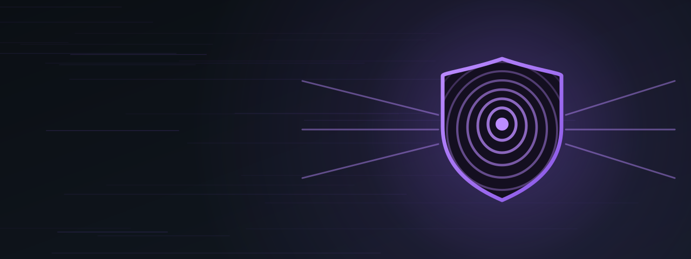

<p align="center"></p>

<p align="center">
  
  
  
  
  
</p>

# WG Shield - arm64

An always-on **WireGuard or AmneziaWG tunnel in the kernel, without an app**. It starts at boot, survives killing apps from recents, follows Wi-Fi ↔ mobile data by itself and has a **kill switch**: while a tunnel is on but not working, nothing leaves the phone around it. Import your tunnels (Proton VPN configs work as downloaded, AmneziaWG configs are recognised by themselves), switch one on, done.

Android sees no VPN - no key icon, no `VpnService`, nothing an app can detect or trip over. Calls over the mobile network (VoLTE, Wi-Fi calling), SMS and MMS keep using the carrier's own networks.


---

## Why

- A normal VPN app dies when you clear recents; Android's *Always-on VPN* then locks you out until the app comes back
- The WireGuard app **with root** (kernel backend) stays up, but builds an Android VPN network by hand - and on this phone that broke Telegram calls (no UDP through the tunnel: it rings, never connects)
- WG Shield does neither: it is plain Linux routing below Android, run by a watchdog. Telegram calls, normal calls and SMS work with the tunnel up (tested on the device)

---

## Features

- **Kernel WireGuard, no app** - one interface, `wgs0`, whichever tunnel is on
- **AmneziaWG too** - a config with AmneziaWG settings (`Jc`, `S1`-`S4`, `H1`-`H4`, `I1`-`I5`, `HeaderProtectionKey`…) runs as an AmneziaWG tunnel, any other as plain WireGuard. Nothing to choose: the type is read from the file, the tunnel row shows an **AWG** badge. Same routing, kill switch and networking set for both
- **Every tunnel a switch** - import the WireGuard app's export zip or single `.conf` files (WireGuard or AmneziaWG); one tunnel on at a time, all off = your normal connection
- **Kill switch** - tunnel on but not answering (no handshake for 180 s, WireGuard's own limit) → no internet at all, never the plain connection; from the first second of boot when a tunnel was on
- **Your choice is not a failure** - turn the tunnel off or pause it (15 min / 1 h / 4 h) and the phone simply uses your connection
- **IPv4 and IPv6** - a tunnel with an IPv6 address and `::/0` carries IPv6 too; one without blocks IPv6 while it is on, so nothing goes around it
- **Wi-Fi ↔ mobile data** - followed the moment Android switches: the watchdog watches Android's network rules and acts at once, not on its next check
- **Every internet network, not only the current one** - mobile data kept up in the background while you are on Wi-Fi, a Wi-Fi Android is still checking: whatever an app or Android sends over them goes through the tunnel too. A new network is caught the moment Android creates it. Only Android's own network check and the login page of a hotel / airport Wi-Fi go out on the network itself, so a broken Wi-Fi is never taken for a working one and a login page can open
- **Host-name endpoints** - a home server on dynamic DNS works; the name is looked up again if the tunnel stops answering
- **Steps aside for VPN apps** - connect WireGuard, Proton VPN or v2rayNG and WG Shield pauses itself, until that VPN disconnects
- **Local stays local** - your Wi-Fi LAN (router, printer, SSH from a laptop) and hotspot devices are reached directly
- **Private keys stay private** - stored root-only, never shown in the WebUI, the log, the status or the report (the same for AmneziaWG's `HeaderProtectionKey`)
- **Action button** in the root manager - tunnel on / off without opening anything
- **WebUI** - route at a glance, exit address on demand, tunnels, import, kill switch, pause, log, report, help

---

## How it works

```
app on the phone
      ↓
routing rules 5000–5022  (before Android's own, which start at 10000)
      ↓
wgs0 - the kernel tunnel (WireGuard or         table 51820: default dev wgs0
       AmneziaWG), encrypted
      ↓                                                    + unreachable (kill switch)
your Wi-Fi or mobile network → VPN server → internet
```

| Rule | What for |
|---|---|
| 5000 | The tunnel's own encrypted packets to the server go out through your network |
| 5010–5013 | Local destinations stay local: Wi-Fi LAN, hotspot devices, the local range of every other network |
| 5014 | Android's own network check (NetworkStack) and the captive portal login page stay on the network they are for |
| 5020 | Everything not bound to one network → the tunnel |
| 5021 | Everything bound to the current default network → the tunnel |
| 5022 | Everything bound to another internet network (mobile data in the background, a Wi-Fi not yet in use) → the tunnel |

Carrier service networks keep Android's routing - that is how IMS (VoLTE, Wi-Fi calling) and MMS keep working. Which network is which comes from Android itself: restricted networks (IMS and the like) are never touched, networks without internet (MMS only) are left alone after one look at `dumpsys connectivity`. No firewall (iptables) rules at all: nothing can conflict with Android's firewall lock or with the other modules' chains.

`wgs0` is created with the type of the tunnel that is on (`wireguard` or `amneziawg`) and set up with the matching tool (`wg` or `awg`). Switching between the two types creates `wgs0` again; the `unreachable` route keeps the kill switch closed meanwhile.

A watchdog follows Android's network rules as they change (`ip monitor`): a new network goes through the tunnel within a fraction of a second, a new default network is followed at once. On top of that it checks every 10 seconds (every 2 s during the first minute after boot): the right tunnel loaded, every rule in place. Rules are changed without a gap - the new ones are in place before the old ones go - so the kill switch never opens. Anything off is put back and logged.

---

## Requirements

| | |
|---|---|
| CPU | arm64 |
| Kernel | WireGuard built in (`CONFIG_WIREGUARD`) - the installer checks and stops if it is missing |
| Kernel, for AmneziaWG | AmneziaWG built in or loaded (`CONFIG_AMNEZIAWG`, `/sys/module/amneziawg`) - optional: without it only AmneziaWG tunnels cannot start (their switch is greyed out), WireGuard tunnels work as usual |
| Root | SukiSU Ultra or KernelSU (WebUI built in) · APatch · Magisk (WebUI via MMRL or KSU WebUI Standalone) |
| Android | 12+ (tested on 16) |
| Tunnels | wg-quick format (WireGuard or AmneziaWG): one `[Peer]`, `AllowedIPs` with `0.0.0.0/0`, an `Endpoint` as an IPv4 address or a host name |

### Tested on

Poco F6 Pro (vermeer), Xiaomi.eu ROM (HyperOS 3, Android 16), custom kernel [GKI_Kernel_SukiSU](https://github.com/nikakvo/GKI_Kernel_SukiSU) (SukiSU Ultra, WireGuard and AmneziaWG 3.1.20260812 built in), with Proton VPN WireGuard configs (IPv4 and IPv4 + IPv6) and a self-hosted AmneziaWG 3.1 server - on Wi-Fi and on mobile data, together with DNSCrypt Proxy Arm64, ipset-arm64 and VPN Hotspot Arm64. Other devices, ROMs and kernels should work (the routing is Android's own netd layout) but are not tested - reports welcome.

---

## Installation

1. Flash `wg-shield-arm64-vX.X.zip` in your root manager, reboot
2. WireGuard app: **⋮ → Export tunnels** (a zip in Download) - or download `.conf` files from your VPN provider. An AmneziaWG config: put the `.conf` file in Download
3. WebUI → **Tunnels → Import from Download → Import**, then delete the file there (**✕**) - it holds your private keys
4. Disconnect the tunnel in the WireGuard / AmneziaWG app (one key, one tunnel)
5. Switch a tunnel on - the route at the top shows **Phone → tunnel → Internet**

Tunnels and settings are kept on update.

---

## WebUI

| Tab | |
|---|---|
| Dashboard | Route strip · exit address (tap **Check**) · tunnel: type, server, handshake, traffic, IPv6, network, the other networks · the networking set · watchdog |
| Tunnels | Every tunnel with a switch (one at a time), an **AWG** badge for AmneziaWG tunnels, and **✕** · import from Download, delete the export |
| Settings | Kill switch · pause 15 min / 1 h / 4 h, resume · Check now · Report (no keys) |
| Log | Filterable by level |

---

## States

| State | Meaning |
|---|---|
| **Protected** | The tunnel is up: a handshake within the last 180 s |
| **Connecting** | Just switched on, waiting for the first handshake (or for a network) |
| **Down** | No handshake for more than 180 s - kill switch on: no internet; off: direct until it answers again |
| **Paused** | You paused it, or a VPN app is connected - direct connection |
| **Error** | The tunnel cannot be built (file gone, kernel refused it, an AmneziaWG tunnel on a kernel without AmneziaWG) - direct connection, the banner says why |
| **Off** | No tunnel switched on - your normal connection |

---

## IPv6

| DNSCrypt Proxy IP mode | Tunnel with IPv4 only | Tunnel with IPv4 + IPv6 |
|---|---|---|
| `ipv4` (IPv6 off for the phone) | IPv4 | IPv4 - the IPv6 part is not used |
| `compat` | IPv6 blocked | IPv6 through the tunnel |
| `dual` | IPv6 blocked, apps use IPv4 | **full IPv6 through the tunnel** |

Nothing leaks in any combination. Switching the IP mode while a tunnel runs is picked up within seconds. Proton's commented-out IPv6 `Endpoint` line is only another way to reach the server - leave it commented.

---

## The networking set

Four modules built to work together - each one works on its own, and each adds a layer for the phone **and everyone on its hotspot**:

| | Module | What it adds |
|---|---|---|
| 🟢 | [DNSCrypt Proxy Arm64](https://github.com/nikakvo/dnscrypt-proxy-android-arm64-only) | Encrypted DNS with ad / tracker blocklists - for the phone and for hotspot devices |
| 🔵 | [ipset-arm64](https://github.com/nikakvo/ipset_arm64) | IP blocklists (FireHOL, Spamhaus) in the kernel - stops connections to hard-coded IP addresses, which DNS blocking cannot see |
| 🟡 | [VPN Hotspot Arm64](https://github.com/nikakvo/vpn-hotspot-arm64) | Sends hotspot, USB and Bluetooth devices through the phone's VPN, with kill switch |
| 🩵 | **WG Shield Arm64** *(this module)* | Always-on kernel WireGuard / AmneziaWG for the phone, with kill switch - no app |

```
app on the phone  /  device on your hotspot
   │  DNS      → DNSCrypt Proxy   encrypted, filtered
   │  traffic  → ipset            listed networks dropped
   │  hotspot  → VPN Hotspot      into the tunnel (kill switch)
   ▼  tunnel   → WG Shield        kernel WireGuard / AmneziaWG, always on (kill switch)
internet
```

- **DNS stays with DNSCrypt Proxy** - WG Shield never sets DNS (the `DNS =` line of a config is ignored); DNSCrypt's own queries simply travel inside the tunnel. Its System tab shows *Through WG Shield · tunnel*
- **Hotspot devices follow the tunnel** - WireGuard or AmneziaWG alike: VPN Hotspot (1.0-r13 or newer) reads WG Shield's status: through the tunnel when it is up, direct when you turn it off or pause it, blocked when it fails
- **ipset** blocks as always; a tunnel server must never be in its lists (check it with its *Check* tool)
- **No firewall conflicts** - WG Shield uses routing only; the other three read the firewall without taking Android's lock

---

## Files

| Path | |
|---|---|
| `/data/adb/wg-shield/` | Everything the module keeps, in one folder: |
| `  settings.conf` | Settings: active and last tunnel, kill switch |
| `  tunnels/` | Imported tunnels with their keys, root only (`0600`) |
| `  logs/wg-shield.log` | Log |
| `  state/` | Runtime state, cleared at boot; `status` is read by the sibling modules |
| `system/bin/wg` | `wg` from [wireguard-tools](https://git.zx2c4.com/wireguard-tools/) v1.0.20250521, static arm64 - also on the path: `su -c '/system/bin/wg show wgs0'` |
| `system/bin/awg` | `awg` from [amneziawg-tools](https://github.com/amnezia-vpn/amneziawg-tools) 3.1.20260812, static arm64 - for an AmneziaWG tunnel: `su -c '/system/bin/awg show wgs0'` (that output includes the header protection key - do not share it; `ctl.sh diag` hides it) |

### Status file (for other modules)

`/data/adb/wg-shield/state/status`, rewritten atomically on every watchdog pass (up to 1.0-r3: `/data/adb/wg-shield-state/status` - a copy is kept there only while VPN Hotspot older than 1.0-r15 or DNSCrypt Proxy older than 2.1.18-r23 is installed):

```
state=up|handshaking|down|paused|off|error
reason=…            iface=wgs0            table=51820         type=wireguard|amneziawg
tunnel=<name>       endpoint=<ip:port>    endpoint_host=<host:port, if a name>
handshake_age=<s>   killswitch=1|0        ipv6=tunnel|blocked|off
default_net=…       android_vpn=…         updated=<epoch>
```

---

## Command line

```sh
# from Termux
su -c '/system/bin/sh /data/adb/modules/wg-shield/ctl.sh status'
su -c '/system/bin/sh /data/adb/modules/wg-shield/ctl.sh list'
su -c '/system/bin/sh /data/adb/modules/wg-shield/ctl.sh import /sdcard/Download/wireguard-export.zip'
su -c '/system/bin/sh /data/adb/modules/wg-shield/ctl.sh import /sdcard/Download/amneziawg.conf'
su -c '/system/bin/sh /data/adb/modules/wg-shield/ctl.sh up [name]'   # last used when no name
su -c '/system/bin/sh /data/adb/modules/wg-shield/ctl.sh switch <name>'
su -c '/system/bin/sh /data/adb/modules/wg-shield/ctl.sh down'   # normal connection
su -c '/system/bin/sh /data/adb/modules/wg-shield/ctl.sh pause <minutes>'
su -c '/system/bin/sh /data/adb/modules/wg-shield/ctl.sh resume'
su -c '/system/bin/sh /data/adb/modules/wg-shield/ctl.sh set killswitch 0|1'
su -c '/system/bin/sh /data/adb/modules/wg-shield/ctl.sh remove <name>'
su -c '/system/bin/sh /data/adb/modules/wg-shield/ctl.sh log [lines|clear]'
su -c '/system/bin/sh /data/adb/modules/wg-shield/ctl.sh diag'   # report, no keys
```

---

## Verify

```
curl https://ifconfig.me          → the VPN's address
```

Then block the server for a moment (the tunnel's *Server* on the Dashboard): internet stops at once - nothing goes around the tunnel.

```sh
su -c '/system/bin/iptables -I OUTPUT -d <server-ip> -j DROP'     # test
su -c '/system/bin/iptables -D OUTPUT -d <server-ip> -j DROP'     # undo - back within seconds
```

---

## Notes

- **"Down" shows up to 3 minutes late** - WireGuard itself counts a session as dead only after 180 s. Your traffic stops at once; only the label waits
- **Host-name endpoints** are looked up with one plain DNS query to Quad9 outside the tunnel (the tunnel is not up yet); the same resolvers DNSCrypt Proxy lets root query directly
- **Same LAN on both sides** - addresses of your own Wi-Fi network always stay local; a home VPN that uses the same range (both `192.168.1.x`) cannot reach its devices while you are on that Wi-Fi
- **Need internet now?** Action button (off), or disable the module in the root manager and reboot - nothing of it stays active

---

## Uninstall

Remove the module in your root manager and reboot. The tunnel and every rule are removed, then settings, log and **all imported tunnels with their keys** are deleted.

---

## Build `wg` and `awg`

`build.sh` (in this repo) downloads wireguard-tools v1.0.20250521 and amneziawg-tools (pinned to commit `ee0f0a9aa34ff0a0da4b3433b9512781cfe02843`, 3.1.20260812) and builds both as static arm64 binaries with [zig](https://ziglang.org):

```sh
bash build.sh                 # → out/wg and out/awg, copy to system/bin/
ZIG=/path/to/zig bash build.sh
```

The build is reproducible with zig 0.16.0. SHA-256 of the files in the release:

| File | SHA-256 |
|---|---|
| `wg` | `b460f9dddaa75b1293eefdd6f7152a30ccf3ffa19267968c52654efdbe056cd0` |
| `awg` | `db3c9a3e384e8bf779fd72408db59b7e061ce214f570438f0e6a87f9fa559a04` |

---

## License

The module (scripts, WebUI) is [MIT](LICENSE). `system/bin/wg` (wireguard-tools) and `system/bin/awg` (amneziawg-tools) are GPL-2.0 - see [THIRD_PARTY_NOTICES.md](THIRD_PARTY_NOTICES.md).

"WireGuard" and the "WireGuard" logo are registered trademarks of Jason A. Donenfeld. WG Shield is not affiliated with or endorsed by the WireGuard or AmneziaWG projects.
